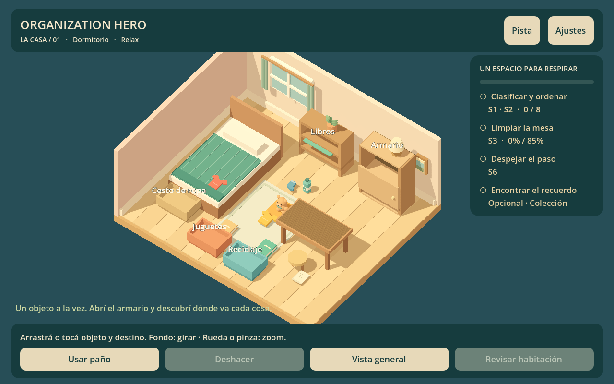

# Organization Hero: 6S Mastery

Prototipo jugable **0.1.2** de organización y limpieza en un dormitorio 3D. Godot **4.7.2**, GDScript tipado, modo Relax, español e inglés.



## Jugar

**Con Godot:** importar `project.godot`, abrir el proyecto y presionar **F5**. La habitación, los objetos y el HUD se generan al ejecutar; la escena de arranque muestra solo el coordinador en el editor.

**Versión Windows local:** ejecutar `build/OrganizationHero.exe`. Mantener `OrganizationHero.pck` en la misma carpeta. Los binarios se generan con el comando de exportación indicado abajo y no se versionan en Git.

- Arrastrar objetos hacia su destino o tocar primero el objeto y después su lugar: libros, ropa, reciclaje y juguetes.
- Al seleccionar, los destinos disponibles muestran un borde dorado y sus lugares libres. Un rechazo conserva la selección para volver a intentar. El botón «Cancelar selección» permite salir con mouse o touch.
- Tocar el armario para abrirlo. La ropa también puede ir al cesto.
- Arrastrar el fondo o usar botón derecho para girar la cámara; rueda para zoom.
- En touch: arrastrar y usar dos contactos para pinza/orbitar.
- Activar el paño y recorrer la mesa; el objetivo requiere 85% de cobertura.
- Despejar el paso guardando el peluche y tocar el recuerdo dorado que aparece.
- Al completar los objetivos obligatorios, revisar la habitación.
- Comparar antes/después o repetir; el coleccionable permanece registrado.

Atajos: **C** paño, **U** deshacer, **Espacio** vista general, **Esc** cancelar/cerrar ajustes. Los ajustes permiten cambiar idioma, volumen, animaciones y vibración opcional.

## Qué funciona

Ocho objetos, cinco destinos con categorías/capacidad/tolerancia, armario con puerta animada, dos destinos válidos para ropa, selección/arrastre/colocación con dos toques/cancelación, deshacer organización, limpieza espacial progresiva, riesgo simple de tropiezo, hallazgo oculto, objetivos, pistas que eligen destinos disponibles, resultados con puntuación/estrellas, comparación y repetición. Reducir animaciones afecta objetos, puerta y transición de cámara.

Progreso JSON versionado con temporal y respaldo bajo `user://`. Ajustes separados. Las versiones futuras de progreso se conservan sin sobrescribir. Prendas, medias y peluche con siluetas propias, dormitorio con nuevos detalles y geometría agrupada por material. Sonidos de tela, papel, plástico, objetos blandos y madera; roce del paño según movimiento y silencio al detenerse. Audio sintetizado de desarrollo; sin SDK comerciales.

## Verificación

Desde PowerShell, con Godot 4.7.2 instalado:

```powershell
.\tools\verify.ps1
.\tools\verify.ps1 -Graphics
.\tools\export-prototype.ps1 -Android -Graphics
```

Se puede indicar `-GodotExecutable` si está en otra ruta. Android requiere JDK/SDK, plantillas coincidentes y configuración Android del editor. VS Code incluye configuración para la instalación local; sus rutas se ajustan en otras computadoras. La depuración interactiva de VS Code aún no se verificó.

Resultados de 0.1.2: **58 comprobaciones de reglas/persistencia**, **30 de geometría/audio**, **64 de integración en Mobile**, **64 en Compatibility**, **64 sobre el paquete exportado** y **6 de datos exportados**, sin fallos. Copia sin caché, arranque y firma APK verificados. Las pruebas gráficas simulan eventos mediante la entrada del motor; no equivalen a touch físico.

El formato de progreso y los IDs del dormitorio siguen en versión 1: las partidas de 0.1.0 y 0.1.1 continúan siendo compatibles. Nuevas formas/perfiles son presentación; no cambian posiciones, capacidad ni objetivos.

La verificación genera `build/audio/material-preview.wav` con una muestra de los sonidos. El [registro de recursos](docs/ASSET_REGISTER.md) documenta procedencia, producción y pruebas pendientes de escucha.

La conversión de Resources a binario se desactiva porque, en la exportación probada, vaciaba categorías/posiciones. La regresión se comprueba contra el paquete, además de probar desde el editor.

## Entregas y límites

`build/OrganizationHero-debug.apk`: Android ARM64 de depuración, firma v2/v3 verificada, aproximadamente **27.15 MiB**. No se instaló en un teléfono. Ese tamaño no acredita la descarga de una futura AAB comercial.

`build/OrganizationHero.exe` + `.pck`: aproximadamente **98.51 MiB** en conjunto. Arranque independiente verificado; ciclo completo del paquete comprobado usando el Godot instalado.

Escenario y audio provisionales. Faltan pruebas con jugadores, arte/audio definitivos, mediciones móviles y validación de dispositivos. Matías todavía no dispone de Android. iOS queda pendiente de macOS/Xcode y hardware Apple. No se declaran cumplidos los objetivos móviles de FPS.

## Documentación

- [Informe del primer prototipo](docs/PROTOTYPE_REPORT.md).
- [Arte y sonido](docs/ASSET_REGISTER.md).
- [Diseño](docs/GAME_DESIGN_DOCUMENT.md).
- [Arquitectura](docs/TECHNICAL_ARCHITECTURE.md).
- [Decisiones técnicas](docs/TECHNICAL_DECISIONS.md).
- [Hoja de ruta](docs/DEVELOPMENT_ROADMAP.md).
- [Pruebas y aceptación](docs/TEST_PLAN.md).
- [Análisis inicial](docs/ORCHESTRATION_PLAN.md).
- [Historial](docs/CHANGELOG.md).
- [Prompt original](docs/MASTER_PROMPT.md).

Desarrollo conectado a [GitHub](https://github.com/msatelier/ORGANIZATION-HERO_6S-MASTERY). Primera implementación en `feat/bedroom-vertical-slice`.
