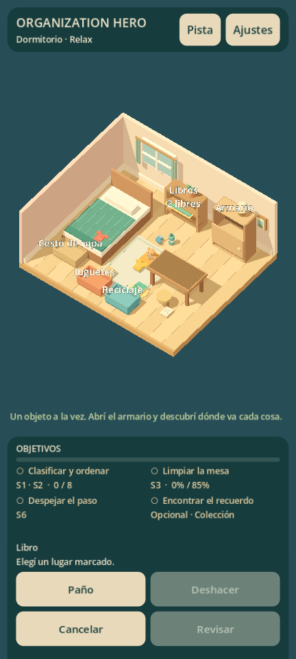

# Informe del prototipo jugable

14 de octubre de 2026. Versión 0.1.3 de desarrollo. Godot 4.7.2.stable.official.ed1daf0bf.

## Entrega

Vista principal vertical para smartphone, elegida por Matías: proporción 9:20 y ventana Windows 432 × 960. La interfaz redistribuye objetivos y acciones, la cámara se ajusta al espacio restante y los cuatro bordes respetan zonas seguras. La distribución horizontal se prueba también. [Detalle móvil y música](MOBILE_PRESENTATION.md).

Dormitorio 3D con ocho objetos. Clasificación por categoría, dos destinos válidos para prendas, armario con puerta animada, encaje animado, rechazo, cancelación y deshacer. Cámara orbital limitada, zoom, foco sobre mesa y equivalentes mouse/touch.

Primera mejora artística: prendas/medias con silueta, peluche redondeado, libros con cubiertas, botella etiquetada y hojas con detalles. Cortinas, planta, lámpara, manta y alfombra enriquecen el diorama. Geometría agrupada por material sin fusionar las partes que deben moverse o interactuar por separado.

Se puede arrastrar o seleccionar con un toque/clic y tocar/clicar después el destino. Los lugares disponibles muestran borde y capacidad restante. Preview y colocación usan la misma validación de categoría, apertura, capacidad y orientación. Un rechazo conserva selección para reintentar; cancelar la limpia con botón contextual o Esc. Las pistas eligen un destino disponible antes de sugerir abrir el armario.

El punto de agarre se conserva durante el arrastre; un botón ajeno no termina el gesto. Agarrar un objeto en animación lo detiene hasta soltarlo o cancelar. Reducir animaciones afecta objetos, puerta y transición de cámara.

Limpieza real mediante máscara CPU de 64 × 40, textura RGBA y shader sencillo. El trazo interpola zonas recorridas y cuenta celdas distintas; repetir un punto no aumenta cobertura. Umbral en datos: 85%.

Guardar el peluche despeja el paso y revela el coleccionable. Objetivos y estado 6S derivados, pistas, inspección final, puntuación, dos estrellas por completar y tercera por el hallazgo opcional. Las estrellas no bloquean progreso.

Guardado y repetición con hallazgo conservado. Antes/después reconstruye representación inicial/final sin mutar progreso. Localización nativa español/inglés y ajustes de audio, animaciones y háptica opcional.

Cinco perfiles sonoros (tela, papel, plástico, blando y madera), tres variantes por perfil, armario con apertura/cierre diferentes y hallazgo/final. La música sustituye el acorde sostenido: melodía original de 40 segundos a 96 BPM, con bajo, arpegios y percusión suave, preparada previamente. Roce continuo del paño por velocidad, desvanecimiento al detenerse y salida al cancelar. El limitador del mix permanece único al repetir. Valoración de la nueva música y ASMR definitivo pendientes de escucha humana. [Registro de recursos](ASSET_REGISTER.md).

## Integración

Entrada en scenes/app/main.tscn. GameRoot instancia habitación, cámara, HUD, entrada y feedback. Definición en resources/levels/bedroom.tres, nueve tipos de Resource. GameSession mantiene estado/objetivos; PlacementRules valida encaje; SaveStore persiste por IDs.

No hay autoloads. Los servicios viven en la escena. Mobiliario/HUD se generan por código al ejecutar; ItemVisuals construye modelos y MeshBatcher agrupa geometría. Edición visual y refinamiento artístico siguen por mejorar.

La máscara se actualiza cuando cambia cobertura o vista antes/después, una vez por frame de presentación. Otros cambios de estado no repintan suciedad ni reinician una animación cuyo destino sigue siendo el mismo. Guardado al terminar el trazo, en acciones discretas y al suspender/cerrar. Deshacer afecta organización en la sesión y conserva hallazgos; su historial no se persiste.

Esquema de progreso y versión de contenido siguen en 1, con los mismos IDs y posiciones: no se requiere migración desde 0.1.0/0.1.1. ItemData declara sound_profile; el contexto de acciones llega a GameRoot y FeedbackManager sin introducir reglas de audio en la sesión.

## Evidencia ejecutada

| Comprobación | Resultado |
| --- | --- |
| Importación/análisis y arranque | Sin errores |
| Copia sin caché ni traducciones binarias | Importa y arranca en 0.1.3 |
| Reglas, estado y persistencia | 58 comprobaciones, 0 fallos |
| Geometría y PCM | 31 comprobaciones, 0 fallos |
| Distribución / idiomas / márgenes | 36 comprobaciones, 0 fallos |
| Entrada/UI con Mobile | 65 comprobaciones por orientación, 0 fallos |
| Mismo ciclo con Compatibility | 65 comprobaciones por orientación, 0 fallos |
| Ciclo con recursos del PCK exportado | 65 comprobaciones por orientación, 0 fallos |
| Datos/localización/música del paquete | 7 comprobaciones, 0 fallos |
| Ejecutable Windows independiente | Arranque headless sin errores |
| APK Android ARM64 debug | Exportación y firma v2/v3 verificadas |
| Android físico | Pendiente: no hay dispositivo |
| iOS | Pendiente |
| Usabilidad y escucha con jugadores | Pendientes |

La entrada usa Input.parse_input_event: arrastre inválido/válido, colocación con dos toques, rechazo de destino lleno, pistas disponibles, deshacer, touch cancelado, agarre y botón de finalización, ajustes táctiles, animación/reducción, contenedor, pinza, clasificación, hallazgo, barrido de limpieza, persistencia, resultados, comparación y repetición. Las imágenes vienen del viewport real.

PC: NVIDIA GeForce RTX 4050 Laptop GPU. Mobile: Vulkan 1.4.325; Compatibility: OpenGL 3.3, controlador NVIDIA 592.82. Ciclos en 432 × 960 y 960 × 432. Distribución comprobada además en 450 × 800 y 800 × 600, dos idiomas y márgenes seguros simulados. No son un emulador de S20 ni demuestran FPS móviles. Los contadores de dibujo de versiones anteriores pertenecen a otro encuadre y resolución.

## Exportaciones

Windows: OrganizationHero.exe + OrganizationHero.pck separados, alrededor de 100.20 MiB en conjunto. Ambos deben permanecer juntos.

Android: OrganizationHero-debug.apk, alrededor de 28.57 MiB. Identificador com.msatelier.organizationhero.prototype, versión 0.1.3 (código 4), orientación portrait, mínimo declarado API 24 y objetivo API 36. El mínimo declarado no certifica soporte gráfico en todos esos dispositivos. Permiso normal de vibración; sin Internet solicitado por el preset.

APK sin prueba física, firma comercial ni AAB para tienda. El peso del archivo no equivale a descarga comercial distribuida. Los binarios y registros quedan en build, excluido de Git.

## Problemas detectados y resueltos

- Objeto oculto detrás del escritorio: reubicado y comprobado.
- Tipos inválidos en progreso: validación previa y recuperación probadas.
- Traducciones de texto cargadas antes de los loaders: registro nativo después de inicialización, desde Resources versionados.
- Conversión binaria vaciaba categorías y slots en esta exportación: desactivada y cubierta por prueba del paquete; causa interna del motor no determinada.
- PCK incrustado provocaba bloqueo de Application Control: exportación estándar con binario del motor sin modificar y datos separados; arrancó con la política existente.
- Referencia de audio retenida en salida automática headless: audio desactivado en esa prueba y parada explícita al cerrar.
- Selección cancelada retenía guías; se limpia junto con el estado del gesto.
- Cualquier botón de mouse podía terminar un arrastre; ahora solo el que lo inició.
- Pequeño desplazamiento al agarrar durante un retorno animado; animación pausada desde el contacto inicial y agarre comprobado.

## Pendientes y próximo hito

Ajustar selección, tolerancias y ayudas con uso humano; evaluar la nueva música, reconocimiento de formas y comodidad; revisar interfaces en tamaños físicos. Gestos y zonas seguras implementados y simulados, todavía sin validación en teléfono.

Solo existe esquema 1: versiones desconocidas protegidas, sin migraciones históricas todavía. No hay galería independiente, campaña, modo Desafío completo, anuncios, compras, nube ni SQLite.

Experiencia completa en vista vertical de smartphone, con distribución adaptable y música de juego. Aceptación móvil y refinamiento comercial abiertos. Próximo trabajo: devolución de Matías, preparación de contenido reutilizable y mediciones Android cuando haya dispositivo.
