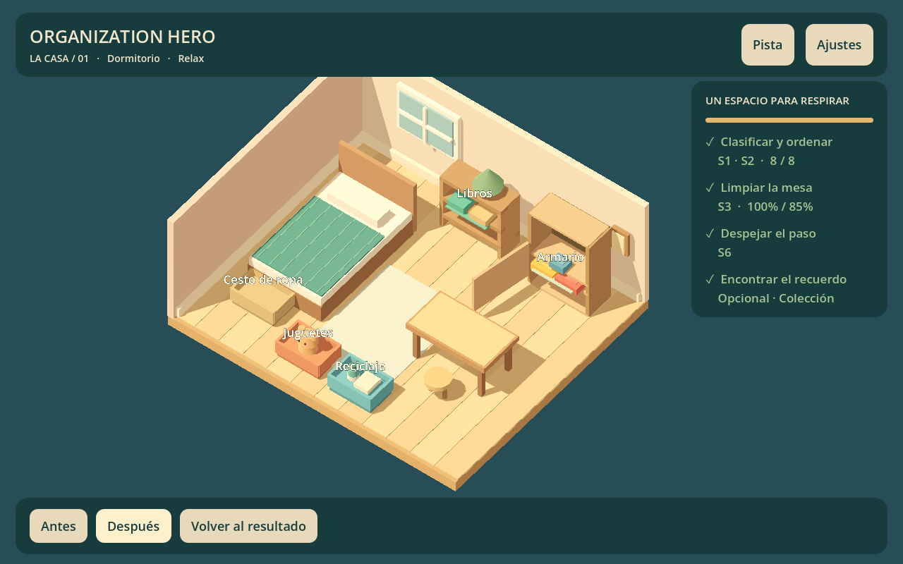

# Informe del primer prototipo jugable

13 de octubre de 2026. Versión 0.1.0 de desarrollo. Godot 4.7.2.stable.official.ed1daf0bf.

## Entrega

Dormitorio 3D con ocho objetos. Clasificación por categoría, dos destinos válidos para prendas, armario con puerta, encaje animado, rechazo, cancelación y deshacer. Cámara orbital limitada, zoom, foco sobre mesa y equivalentes mouse/touch.

Limpieza real mediante máscara CPU de 64 × 40, textura RGBA y shader sencillo. El trazo interpola zonas recorridas y cuenta celdas distintas; repetir un punto no aumenta cobertura. Umbral en datos: 85%.

Guardar el peluche despeja el paso y revela el coleccionable. Objetivos y estado 6S derivados, pistas, inspección final, puntuación, dos estrellas por completar y tercera por el hallazgo opcional. Las estrellas no bloquean progreso.

Guardado y repetición con hallazgo conservado. Antes/después reconstruye representación inicial/final sin mutar progreso. Localización nativa español/inglés y ajustes de audio, animaciones y háptica opcional. Audio sintetizado provisional; producción ASMR definitiva pendiente.

## Integración

Entrada en scenes/app/main.tscn. GameRoot instancia habitación, cámara, HUD, entrada y feedback. Definición en resources/levels/bedroom.tres, nueve tipos de Resource. GameSession mantiene estado/objetivos; PlacementRules valida encaje; SaveStore persiste por IDs.

No hay autoloads. Los servicios viven en la escena. Mobiliario/HUD se generan por código al ejecutar; edición visual y producción artística siguen por mejorar.

La máscara se actualiza cuando cambia cobertura, una vez por frame de presentación. Guardado al terminar el trazo, en acciones discretas y al suspender/cerrar. Deshacer afecta organización en la sesión y conserva hallazgos; su historial no se persiste.

## Evidencia ejecutada

| Comprobación | Resultado |
| --- | --- |
| Importación/análisis y arranque | Sin errores |
| Copia sin caché ni traducciones binarias | Importa y arranca |
| Reglas, estado y persistencia | 52 comprobaciones, 0 fallos |
| Entrada/UI con Mobile | 34 comprobaciones, 0 fallos |
| Mismo ciclo con Compatibility | 34 comprobaciones, 0 fallos |
| Ciclo con recursos del PCK exportado | 34 comprobaciones, 0 fallos |
| Datos/localización del paquete | 5 comprobaciones, 0 fallos |
| Ejecutable Windows independiente | Arranque headless sin errores |
| APK Android ARM64 debug | Exportación y firma v2/v3 verificadas |
| Android físico | Pendiente: no hay dispositivo |
| iOS | Pendiente |
| Usabilidad y escucha con jugadores | Pendientes |

La entrada usa Input.parse_input_event: arrastre inválido/válido, deshacer, touch cancelado, ajustes táctiles, contenedor, pinza, clasificación, hallazgo, barrido de limpieza, persistencia, resultados, comparación y repetición. Las imágenes vienen del viewport real.

PC: NVIDIA GeForce RTX 4050 Laptop GPU. Mobile: Vulkan 1.4.325; Compatibility: OpenGL 3.3, controlador NVIDIA 592.82. Resolución 1280 × 800. Contador puntual tras repetición: 187 draw calls en Mobile y 294 en Compatibility. No son promedios de frame time ni demuestran rendimiento móvil.

## Exportaciones

Windows: OrganizationHero.exe + OrganizationHero.pck separados, alrededor de 98.49 MiB en conjunto. Ambos deben permanecer juntos.

Android: OrganizationHero-debug.apk, alrededor de 27.13 MiB. Identificador com.msatelier.organizationhero.prototype, versión 0.1.0, mínimo declarado API 24 y objetivo API 36. El mínimo declarado no certifica soporte gráfico en todos esos dispositivos. Permiso normal de vibración; sin Internet solicitado por el preset.

APK sin prueba física, firma comercial ni AAB para tienda. El peso del archivo no equivale a descarga comercial distribuida. Los binarios y registros quedan en build, excluido de Git.

## Problemas detectados y resueltos

- Objeto oculto detrás del escritorio: reubicado y comprobado.
- Tipos inválidos en progreso: validación previa y recuperación probadas.
- Traducciones de texto cargadas antes de los loaders: registro nativo después de inicialización, desde Resources versionados.
- Conversión binaria vaciaba categorías y slots en esta exportación: desactivada y cubierta por prueba del paquete; causa interna del motor no determinada.
- PCK incrustado provocaba bloqueo de Application Control: exportación estándar con binario del motor sin modificar y datos separados; arrancó con la política existente.
- Referencia de audio retenida en salida automática headless: audio desactivado en esa prueba y parada explícita al cerrar.

## Pendientes y próximo hito

Ajustar selección, tolerancias y ayudas con uso humano; mejorar modelos, puerta, iluminación y sonidos por material; revisar interfaces en tamaños reales. Gestos y zonas seguras implementados, todavía sin validación física.

Solo existe esquema 1: versiones desconocidas protegidas, sin migraciones históricas todavía. No hay galería independiente, campaña, modo Desafío completo, anuncios, compras, nube ni SQLite.

Primera experiencia de escritorio completa y comprobada por automatización. Aceptación móvil y refinamiento comercial abiertos. Próximo trabajo: prueba de Matías, ajustes de claridad/controles y mediciones Android cuando haya dispositivo.
