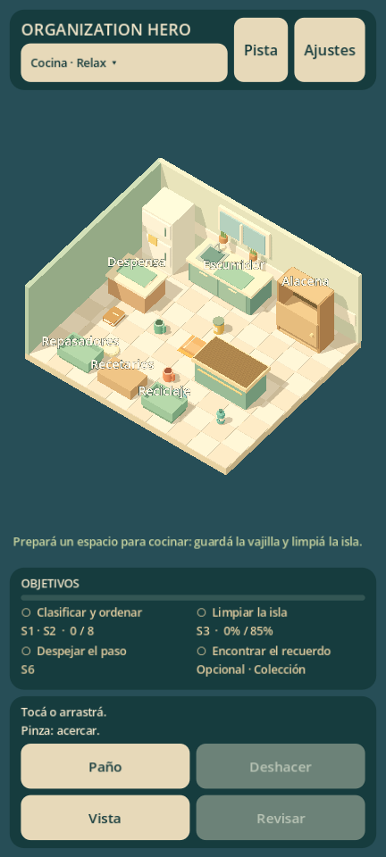
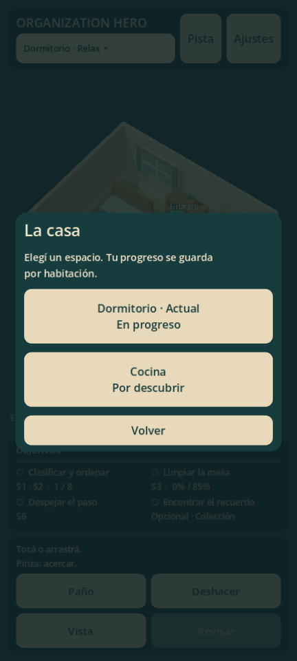

# Casa ampliada — 0.2.0

15 de octubre de 2026. Dos habitaciones abiertas en modo Relax. No hay tiempo límite ni desbloqueo por estrellas.

## Acceso y progreso

Tocar el nombre bajo ORGANIZATION HERO abre «La casa». Se puede cambiar entre dormitorio y cocina en cualquier momento. El selector muestra espacio actual, progreso iniciado o estrellas obtenidas. La última habitación elegida se recupera al abrir la aplicación.

Cada espacio conserva objetos, apertura, cobertura exacta, recuerdo y finalización. Repetir reinicia solo el espacio activo y conserva su recuerdo. Los ajustes de audio, idioma y animación son comunes. La música sigue al cambiar.

| Espacio | Definición | Guardado bajo user:// | Compatibilidad |
| --- | --- | --- | --- |
| Dormitorio | resources/levels/bedroom.tres | progress.json | Archivo original de 0.1.x, sin migración |
| Cocina | resources/levels/kitchen.tres | rooms/home_kitchen_01/progress.json | Esquema 1, contenido 1, ID propio |

Cada archivo mantiene .tmp y .bak en su misma carpeta. Una cocina dañada puede recuperar su respaldo sin leer ni escribir el dormitorio. Un archivo de una versión futura permanece protegido.

## Cocina

| Objetos | Destino | Condición |
| --- | --- | --- |
| Dos tazas | Alacena | Abrir primero; dos lugares |
| Dos platos | Escurridor | Dos lugares |
| Frasco | Despensa | Un lugar |
| Repasador | Cesto de repasadores | Despeja el paso y revela el recuerdo |
| Botella vacía | Reciclaje | Un lugar |
| Recetario | Recetarios | Un lugar |

La isla necesita al menos 85% de superficie limpia. Orden, limpieza y paso libre permiten revisar la habitación y obtener dos estrellas; el recuerdo opcional suma la tercera. La vista antes/después reconstruye el desorden sin cambiar el guardado.

Tazas, platos, frasco y repasador tienen formas nuevas. Baldosas, heladera, fregadero, muebles, isla, ventana y plantas forman el diorama. La alacena conserva el mecanismo compartido de puerta. Los sonidos usan los perfiles de desarrollo existentes; no se incorporó una biblioteca de cerámica ni música adicional.

## Ampliar el contenido

1. Crear un LevelData con ID estable, claves traducidas y datos completos de objetos, destinos, contenedores y tareas. No copiar estado de una sesión.
2. Validar categorías, capacidad, referencias y objetivos. Resolverlo con GameSession sin depender de la escena.
3. Crear la decoración sobre RoomView. Mantener regiones de interacción despejadas y aportar puntos de encuadre si cambia el recinto.
4. Registrar definición y vista en RoomCatalog. Mantener las rutas existentes; asignar subdirectorio propio al nuevo ID.
5. Recorrer la habitación con entrada real del motor y comprobar colocación, limpieza, recuerdo, final, comparación, repetición y reanudación. Probar también el paquete exportado y que el progreso anterior siga intacto.

La cocina reutiliza GameSession, PlacementRules, InteractionController, CameraController, SaveStore, GameHUD y FeedbackManager. RoomView comparte colisiones, objetos, destinos, limpieza, animaciones y comparación; las vistas concretas construyen decoración. Los recipientes se declaran con is_bin y el marcador de seguridad deriva del objeto bloqueante.

Siguiente contenido previsto: baño, sala y garaje, después de revisar esta navegación y el reconocimiento de objetos con Matías. La prueba de escritorio no cierra la aceptación táctil ni de rendimiento Android.
